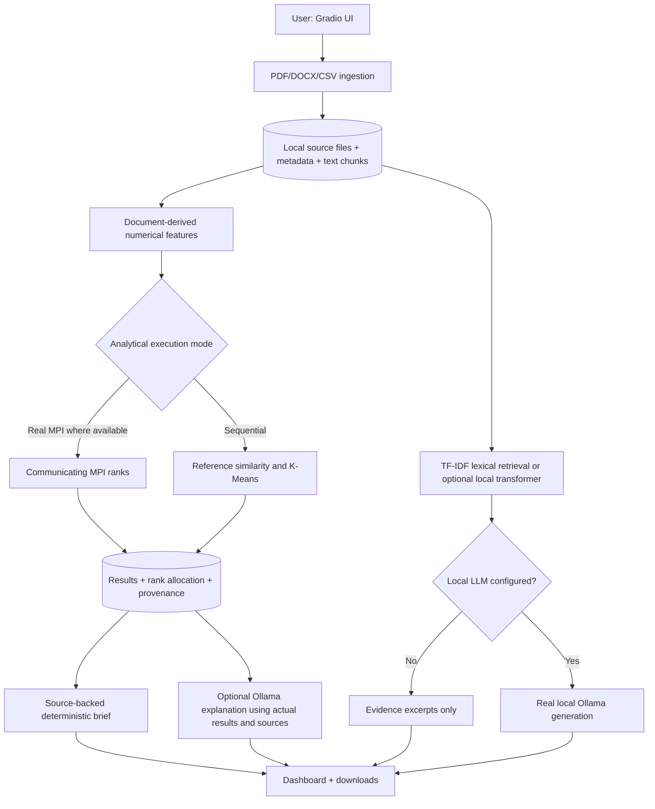
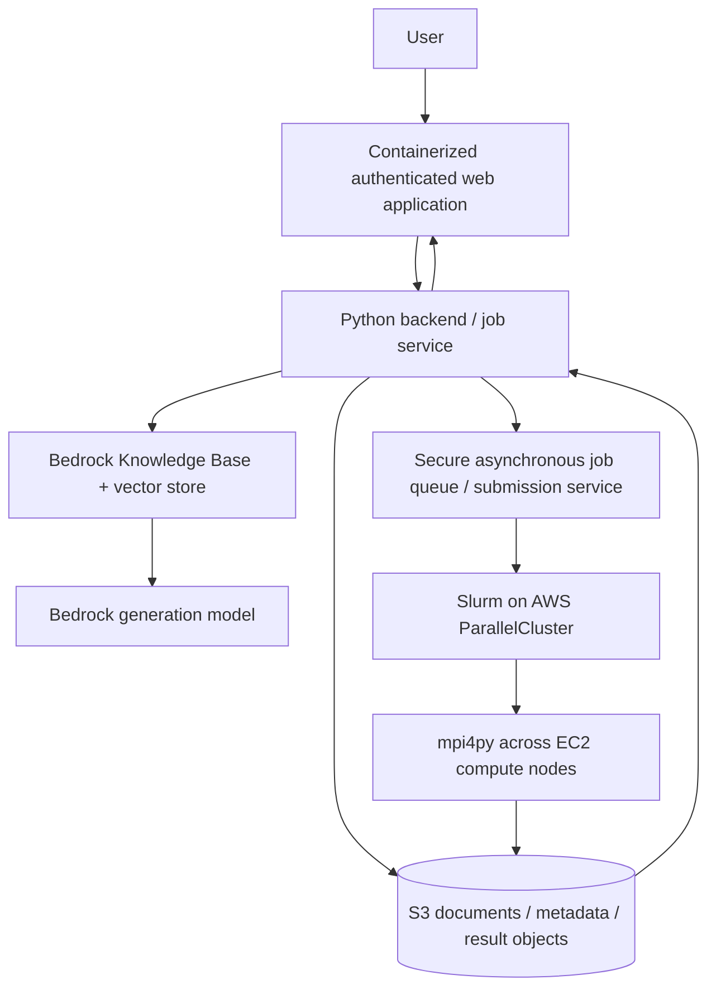

# Architecture and complete workflow

**Submitted title: AI-Powered Market Intelligence & Document Analysis using RAG + HPC on AWS**

## A. Actual local architecture — implemented today

**Read carefully:** standard offline mode is source-evidence retrieval and
sequential numerical analytics. It is not an actual AWS deployment. The MPI
branch requires a verified MPI runtime and real rank execution; it fails rather
than pretending MPI succeeded when unavailable.

## B. Planned AWS architecture — NOT implemented/provisioned

AWS design requires decisions on region, permissions, vector storage, job
submission, VPC networking, persistence, costs and resource cleanup. Container
hosting and compute scheduling are separate tasks. The current Dockerfile
is **local packaging only**, not evidence of AWS deployment.

## Complete user path 1: document understanding

1. Choose a PDF, DOCX or CSV; the app checks type and size.
2. A unique SHA-derived ID connects the saved original to its extracted chunks.
3. Extracted chunks preserve page, paragraph or CSV row source locations.
4. Retrieval ranks likely passages from the uploaded corpus.
5. Without an installed local model, the user sees cited excerpts only.
6. With a configured local Ollama model, the model gets the evidence and question.
7. The app displays a generated answer **and** independent source excerpts.
8. Neither extraction nor generation makes a document's market claims automatically true.

## Complete user path 2: HPC market document analysis

1. Upload multiple documents, then select the HPC Lab.
2. Each document's indexed chunks become one numerical feature vector.
3. The app writes an NPZ input containing unique document IDs and finite vectors.
4. Sequential mode runs a reference algorithm and stores the computed result.
5. Real MPI mode requires `mpiexec` and `mpi4py`, and launches actual processes.
6. Each MPI rank handles a disjoint query-row partition for similarity. For
   distributed K-Means, ranks hold disjoint document vectors and combine
   centroid statistics through `Allreduce`.
7. Results contain runtime, input fingerprint, document manifest and, for MPI,
   verified rank allocation.
8. The Results page presents a table, a chart, raw JSON and a research brief.
9. Optional local Ollama explanation uses the saved findings and source excerpts.
10. The benchmark tool separately compares sequential and MPI runs on identical
    inputs and validates output equivalence.

## Input/output contracts

| Operation | Input | Validated output |
|---|---|---|
| Ingest | PDF/DOCX/CSV file | Document ID, source chunks, metadata |
| Retrieval | Question + corpus | Ranked passages with file/source location |
| Vectors | Indexed documents | NPZ: `doc_ids`, `embeddings` |
| Similarity | Vectors + top-k | Directed pairs, cosine scores, metadata |
| K-Means | Vectors + k | Per-document cluster assignment, centroids, inertia |
| Benchmark | Same NPZ + real MPI runtime | Measured times, correctness, speedup, rank logs |
| Report | Real saved result + indexed source snippets | Deterministic brief or optional local LLM explanation |

## Module guide for the viva

| Module | Why it exists; input → processing → output | Used by; how to test |
|---|---|---|
| `documents.py` | Validates a PDF/DOCX/CSV, extracts located text, chunks it, then stores a document ID and source passages. | UI/CLI; `test_formats.py`, `test_core.py` |
| `storage.py` | Reads and atomically writes local JSON records. Input is a path and Python data; output is a saved record. | Ingestion, jobs, UI; integration tests |
| `vectors.py` | Turns indexed passages into TF-IDF retrieval scores or document vectors; optional local transformer mode is separate. | RAG, analytics, MPI export; `test_core.py`, `test_end_to_end.py` |
| `rag.py`, `local_llm.py` | Ranks evidence, prepares a grounded prompt and optionally requests a local Ollama answer. Without a model, returns cited excerpts. | Documents & AI; `test_rag_llm_contract.py` |
| `analysis.py` | Computes exact cosine top-k and seeded Lloyd K-Means from document vectors. | Sequential mode and correctness reference; `test_core.py` |
| `mpi_tasks.py` | Distributes query rows or K-Means rows across real ranks and gathers/reduces numerical results. | MPI launcher and benchmarks; four-rank WSL2 runs in `VERIFICATION.md` |
| `jobs.py`, `correctness.py` | Launches MPI, checks rank evidence and full output equivalence, then saves success or failure. | HPC UI; `test_research_quality_and_performance.py` and WSL2 jobs |
| `provenance.py`, `report_generation.py` | Attaches input fingerprints/source manifests and creates a deterministic or optional local-LLM explanation. | Results & Reports; `test_report_generation.py` |
| `metrics.py` | Validates comparable CSV series by market, unit, currency and region before calculating YoY/CAGR. | Results & Reports; `test_metrics.py` |
| `ui.py`, `ui_actions.py` | Builds four Gradio pages and connects controls to the backend. | `app.py`; UI tests and browser walkthrough |
| `scripts/benchmark.py`, `scripts/scaling_study.py` | Repeats sequential/MPI runs on the same vectors, verifies results, then records timing and rank evidence. | HPC experiments; WSL2 study in `VERIFICATION.md` |

## Academic claim boundaries

- Hashing/TF-IDF are lexical numerical features, **not** pretrained neural embeddings.
- Exact pairwise similarity is computationally expensive for large N; this is
  an HPC workload with a genuine parallel implementation, not proof that every
  dataset gains speedup.
- The current app is a single-user local prototype; public hosting needs
  identity, database concurrency, private networking and background job management.
