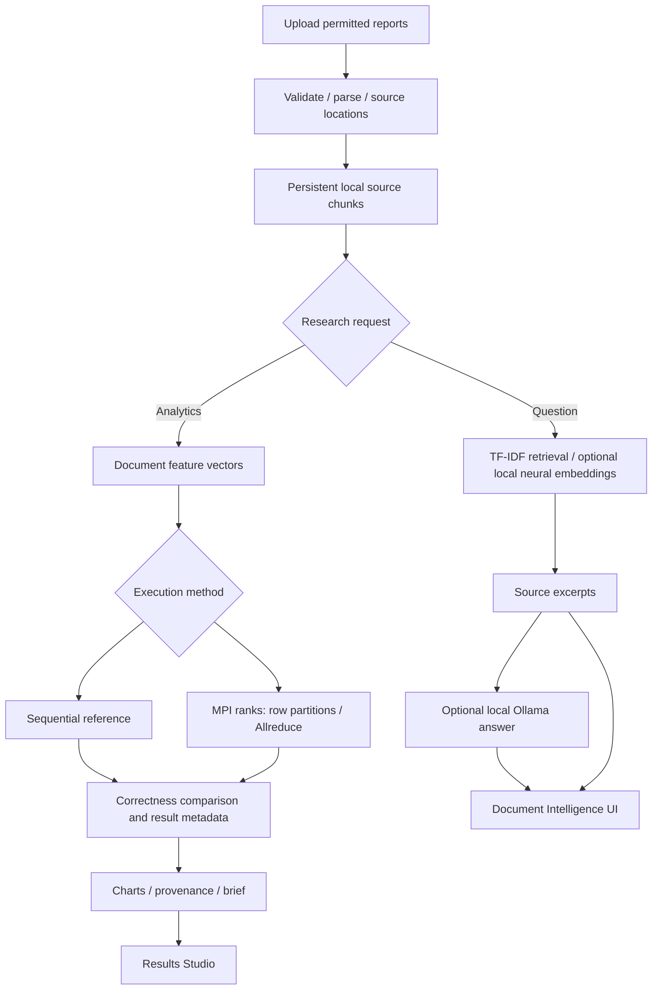

# Final-year engineering blueprint

**Official title — unchanged:** AI-Powered Market Intelligence & Document Analysis using RAG + HPC on AWS

## 1. Research problem

A market analyst may have many PDF, DOCX and CSV reports. Finding a fact is a retrieval problem; comparing large numbers of documents using exact similarity and clustering is a computational problem. A single tool should connect the retrieved evidence to the analytical results without inventing conclusions.

**Research question:** Can a reproducible MPI implementation compute exact document similarity and distributed Lloyd K-Means correctly, and when does it outperform a sequential baseline as workload size and process count increase?

## 2. Correct conceptual architecture

**This is the local architecture.** AWS is not deployed; Slurm and cloud retrieval are future integration steps. No vector database is provisioned by this release.

## 3. What is genuinely implemented

| Subsystem | Current engineering evidence | Key code |
|---|---|---|
| Upload validation | Max-size checks, permitted types, source row/page references | `marketintel/documents.py` |
| Evidence retrieval | Local TF-IDF search; optional installed neural model; deterministic extractive response without an LLM | `marketintel/vectors.py`, `rag.py` |
| Generative answering | Local-only Ollama adapter and offline contract tests; actual model must be installed by user | `marketintel/local_llm.py` |
| Scientific baseline | Exact cosine top-k, deterministic Lloyd K-Means | `marketintel/analysis.py` |
| Parallel source code | Actual `mpi4py` collective operations without simulated MPI fallback | `marketintel/mpi_tasks.py` |
| Correctness | Full top-k comparison and O(n) cluster-permutation equivalence | `marketintel/correctness.py` |
| Experimental scripts | Actual timed sequential vs MPI benchmark, reproducible scaling matrix | `scripts/benchmark.py`, `scripts/scaling_study.py` |
| Documentation | Dataset guides, viva notes, review-only Slurm templates | `docs/`, `infrastructure/slurm/` |
| Dashboard | Four focused pages, source coverage, actual results, provenance receipts | `marketintel/ui.py` |

## 4. HPC necessity, accurately stated

For N documents, d-dimensional vectors, exact all-pairs cosine similarities use approximately O(N²d) arithmetic, even if only top-k similarities are finally stored. There are N(N-1) directed non-self comparisons. MPI distributes query rows across processes, each with the necessary reference vectors. This is a *candidate* for distributed acceleration; speedup must be measured, not assumed.

Distributed K-Means distributes vector rows among ranks; every rank assigns its local data, computes sums and counts, and calls `MPI.Allreduce` to update global centroids. The sequential version is the reference. A cluster ID is **not** a market prediction.

## 5. Evidence-based 11-point rubric

| # | Requirement | Current acceptance target |
|---|---|---|
| 1 | Real-world problem | Use publicly permitted company/market reports with source metadata |
| 2 | Intensive computation | Exact N² comparisons, reproducible dataset sizes |
| 3 | Justification | Complexity and measured crossover point, not just diagrams |
| 4 | Sequential reference | Unit-tested local calculations |
| 5 | Parallel version | Live multi-rank MPI + observed allocation; code alone is not enough |
| 6 | Correctness | Full equivalence, tolerances, label-invariant K-Means comparison |
| 7 | Benchmarks | Real recorded end-to-end wall times |
| 8 | Scalability | Vary N, d, process count; repeat each configuration |
| 9 | Metrics | Speedup, efficiency, throughput, rank CPU time and observed RSS high-water mark |
| 10 | AWS execution | **Student's future task**: submit and observe real Slurm jobs |
| 11 | Cost analysis | **Student's future task**: AWS actual bill, instance type, runtime, cost per analysis |

## 6. Critical limitations (do not hide these in viva)

- AWS, OpenSearch/S3 Vectors and any database are **not deployed**.
- Local TF-IDF is lexical retrieval, not a vector database. Optional local neural embeddings need a separately installed model.
- Ollama answer generation requires an installed local model; deterministic extractive evidence is **not** LLM generation.
- MPI source and launch scripts exist; actual multi-rank correctness and speedup depend on a live MPI runtime, which was not available in the package build environment.
- Synthetic benchmark vectors are not market research evidence.
- Uploaded files use a single-user local JSON store; authentication, persistent multi-user data services, safe job orchestration and cloud resource access need deployment engineering.

## 7. Demonstration flow (6–8 minutes)

1. Open Overview. Explain *Documents → Evidence / Analytics → Provenance*.
2. Import three or more real permitted reports; show unique source IDs and preserved source pages/rows.
3. Ask a factual question. Point out exact evidence and whether a real LLM was used.
4. Open HPC: explain N(N-1) comparisons, run sequential similarity and K-Means.
5. Show top matches, clusters and metadata (file manifest, vector type, SHA-256, runtime).
6. With the configured WSL2 environment, launch real MPI. Show rank/hostname allocation and correctness check.
7. Display saved benchmark charts and explain results **including negative speedup**.
8. If AWS has been deployed, submit real Slurm job and show CloudWatch/Slurm evidence; otherwise label it pending.

## 8. What should be kept separate

Database provisioning, managed vector-store creation, IAM changes, networking and AWS billing are **user-owned**. This repo contains no working database deployment and does not automatically create any resource.
