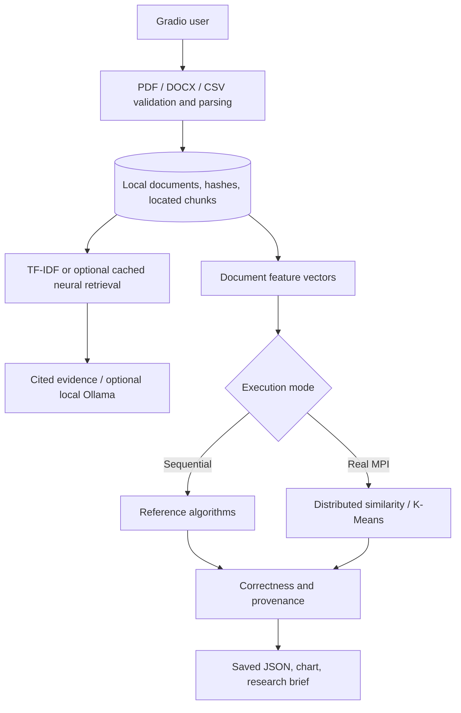

# AI-Powered Market Intelligence & Document Analysis using RAG + HPC on AWS

**Final-year academic report draft — 22 November 2026**  
**Status:** Verified local prototype and single-host MPI; real market case study,
live local LLM, and AWS deployment remain pending. Add the college's official
cover, certificate, author details, and formatting before submission.

## 1. Abstract

This project combines document evidence retrieval with numerical analysis of
report collections. The local application accepts PDF, DOCX, and CSV files,
preserves page or row locations, retrieves relevant passages, and computes
document similarity or K-Means groups. A Sequential implementation provides a
reference for a genuine MPI version. On one Windows host, a 12-configuration
synthetic study with three repetitions per configuration produced correct MPI
results but negative speedup. A second eight-configuration study extended the
input to 2,000 and 5,000 documents; its median end-to-end speedups ranged from
0.039× to 0.350×. Default question answering is evidence-only TF-IDF retrieval. A
local neural model and Ollama generation are optional and were not live tested.
The AWS architecture is prepared as a handoff, not deployed. The work shows a
reproducible local foundation and identifies the evidence still required for a
complete cloud-based final submission.

## 2. Introduction

Market research often requires reading documents from different publishers,
years, and geographies. A useful system must let a researcher find the exact
passage behind an observation and distinguish a document's claim from a
verified market fact. Large collections also create a numerical comparison
problem. This project joins those tasks while keeping the evidence and
computational paths explicit.

## 3. Problem statement

Manual document review is slow and difficult to reproduce. A plain keyword
search may miss context, while a generated answer may state unsupported facts.
Comparing all pairs of document vectors becomes approximately quadratic in
the number of documents. The engineering problem is to preserve source
traceability, provide honest retrieval, compute repeatable relationships,
and test whether MPI helps at a measured scale.

## 4. Objectives

1. Import permitted documents and retain a full content hash and attribution.
2. Retrieve passages with inspectable filename and source location.
3. Offer optional local semantic retrieval and grounded generation without a
   required paid service.
4. Compute exact cosine top-k and Lloyd K-Means with a Sequential baseline.
5. Execute genuine MPI, verify the full output, and record ranks and timing.
6. Present results in a readable dashboard and prepare a secure AWS handoff.

## 5. Literature review

The RAG work of Lewis and colleagues connects retrieval with generation for
knowledge-intensive questions [1]. Our local implementation follows the
general retrieve-then-use-evidence idea, but its default mode is extractive
TF-IDF and it is **not** a reproduction of their trained architecture.
Scikit-learn documents TF-IDF text features [2] and Lloyd-style K-Means [3];
this project uses its text vectorizers but implements its own measured
Sequential and MPI clustering paths. The MPI Forum standard defines the
collective communication model [4] used through `mpi4py`. Public filing
sources such as SEC EDGAR can support a future licensed case study [5]; none
were automatically downloaded into this release.

## 6. Existing approaches and limitations

Reading reports manually keeps context but scales poorly. Keyword retrieval
is fast and reproducible but can miss paraphrases. Neural retrieval can improve
semantic matching, although it adds model and index requirements. A general
LLM may produce fluent text without source support. A Sequential numerical
program is simple and often fastest for small collections. MPI can divide
work across processes, but launch, data movement, and synchronization cost
time. This project exposes those trade-offs instead of presenting any mode as
universally superior.

## 7. Proposed system

The proposed workflow has two connected branches after document ingestion:
question-to-evidence and document-to-numerical-analysis. Both preserve the
same document IDs. Analysis results include algorithm parameters, vector
representation, source manifest, SHA-256 fingerprint, elapsed time, and real
rank allocation when MPI executes. An optional locally installed Ollama model
can draft an answer from retrieved passages, subject to citation-number
validation. A deterministic brief is always available without an LLM.

## 8. System architecture

See `ARCHITECTURE_AND_WORKFLOW.md` for separate ingestion, RAG, similarity,
distributed clustering, local workflow, and proposed AWS diagrams. The AWS
diagram is a design, not a deployment record.

## 9. Technologies used

Python 3.11 is the primary Windows environment. Gradio supplies the four-page
local interface. PyMuPDF, python-docx, and Python CSV utilities extract text.
NumPy and scikit-learn supply numerical arrays and text features. SciPy helps
validate label-invariant centroid equivalence. Plotly renders result charts
and the offline benchmark dashboard. `mpi4py` and an MPI runtime are optional
for actual parallel execution. JSON/NPZ files provide local single-user
storage; they are not a production database. Docker and Slurm files are
review-only deployment templates.

## 10. Methodology

Each nonempty, supported file is size checked and parsed into source units.
Passages use a 180-word window with a 35-word overlap. Duplicate bytes share
a document ID derived from SHA-256. Real-source metadata is imported from a
validated manifest, and synthetic files retain an explicit classification.
Question retrieval and analytics use the indexed passages but answer different
questions. Every MPI benchmark uses the same NPZ input and parameters as its
Sequential counterpart and is rejected if outputs disagree.

## 11. Sequential algorithms

The default analytics vector is a 384-dimensional hashed lexical
representation of each document. For cosine similarity, nonzero vectors are
normalized and each query document is compared with every other document.
The own-row score is excluded. An exact partition cutoff selects candidates,
and cutoff ties are sorted by document ID. For `N` vectors of dimension `d`,
pairwise arithmetic is approximately `O(N²d)`; a block score buffer uses
`O(block_size × N)` memory.

Lloyd K-Means starts with seeded document centroids, assigns each vector to
its nearest centroid, recalculates cluster sums and counts, and stops at the
movement tolerance or iteration limit. Empty clusters retain their previous
centroid. The saved result includes assignments, centroids, inertia, and
iterations. A cluster ID is not a sector label or a market forecast.

## 12. MPI algorithms

Similarity rank 0 loads and normalizes the input, broadcasts the reference
matrix, and gives each rank disjoint query rows. Every rank computes exact
top-k for its rows; rank 0 gathers the rows and saves rank metadata. This
replicates `O(Nd)` reference storage on each rank and may limit scaling.

Distributed K-Means scatters disjoint vector rows. Each rank computes local
assignments, centroid sums, and counts. `MPI.Allreduce` combines those
statistics so every rank updates the same centroids. Final labels and inertia
are gathered. Uneven and empty partitions are supported. The launcher never
substitutes simulated ranks. A completed MPI job is published only after rank
evidence and an independent Sequential comparison pass.

## 13. RAG architecture

Default retrieval uses TF-IDF over indexed passages and cosine scores, then
shows literal excerpts and locations. The optional semantic mode uses a
locally installed SentenceTransformer with a versioned NPZ index. Chunk IDs
and text hashes let it reuse unchanged embeddings; questions use the same
configured model. The optional Ollama mode sends retrieved text to a loopback
service and asks for an evidence-grounded answer. It rejects missing or
out-of-range numbered citations and returns a trusted source appendix. This
mechanical rule cannot prove every claim is supported. No live neural or
Ollama result is reported in this draft.

## 14. Dataset preparation

The release contains clearly labelled synthetic practice documents and
synthetic numerical benchmark vectors. It does **not** contain a licensed
public-report case study. `data/metadata/manifest.example.csv` defines fields
for filename, industry, publisher, source URL, publication date, reporting
period, geography, source type, usage notes, and real/synthetic classification.
The import command retains each file's full content SHA-256 and rejects
conflicting attribution. The student must obtain permitted real reports,
check passages against originals, and label manually verified retrieval
questions. CSV growth calculations require compatible market, year, value,
unit, region, and currency fields; incompatible series are not combined.

## 15. Implementation

`marketintel/documents.py` handles ingestion; `storage.py` provides local
persistence; `vectors.py`, `rag.py`, and `local_llm.py` handle retrieval and
optional generation. `analysis.py` is the Sequential numerical reference;
`mpi_tasks.py`, `jobs.py`, and `correctness.py` execute and check real MPI.
`provenance.py`, `metrics.py`, and `report_generation.py` create traceable
outputs. `ui.py`, `ui_actions.py`, and `ui_theme.py` provide the dashboard.
`scripts/doctor.py`, `verify_local.py`, `benchmark.py`, `scaling_study.py`,
`plot_scaling.py`, and `evaluate_retrieval.py` support verification. The
source ZIP excludes the local virtual environment and personal indexed data.

## 16. Experimental setup

Two studies ran on one Windows host with Python 3.11.9 and Microsoft MPI
10.1.12498.52. The first used synthetic matrices of 100, 500, and 1,000
documents; the second used 2,000 and 5,000 documents. Both used 384 features,
2 and 4 ranks, similarity and clustering, and three repetitions per
configuration. BLAS threads were limited to one. The primary time is
end-to-end wall time including process launch and result output. The MPI
section time and per-rank CPU seconds are recorded separately. Each complete
MPI result was checked against a freshly computed Sequential reference.
The exact platform, input fingerprint, rank allocation, raw repetitions, and
summary CSV/JSON are in `output/benchmarks/native_windows_20261122/` and
`output/benchmarks/native_windows_20261122_large/`. The second study was
bounded after checking 18 logical CPUs and about 3.38 GiB available RAM.

## 17. Results and analysis

| Documents | Workload | Sequential median for 2-rank comparison (s) | MPI 2-rank median (s) | 2-rank speedup | MPI 4-rank median (s) | 4-rank speedup |
|---:|---|---:|---:|---:|---:|---:|
| 100 | similarity | 0.019 | 2.122 | 0.009× | 2.546 | 0.005× |
| 100 | clustering | 0.012 | 2.269 | 0.005× | 2.606 | 0.004× |
| 500 | similarity | 0.058 | 2.557 | 0.023× | 2.889 | 0.020× |
| 500 | clustering | 0.029 | 2.360 | 0.012× | 2.650 | 0.011× |
| 1,000 | similarity | 0.095 | 2.379 | 0.040× | 2.696 | 0.044× |
| 1,000 | clustering | 0.070 | 4.661 | 0.015× | 5.492 | 0.019× |

The larger study also produced these measured medians:

| Documents | Workload | Sequential 2-rank baseline (s) | MPI 2-rank (s) | 2-rank speedup | MPI 4-rank (s) | 4-rank speedup |
|---:|---|---:|---:|---:|---:|---:|
| 2,000 | similarity | 0.576 | 5.344 | 0.108× | 5.401 | 0.125× |
| 2,000 | clustering | 0.206 | 5.122 | 0.040× | 5.206 | 0.039× |
| 5,000 | similarity | 2.378 | 6.885 | 0.345× | 6.380 | 0.350× |
| 5,000 | clustering | 0.614 | 5.667 | 0.108× | 5.585 | 0.107× |

Each rank count had its own measured Sequential baseline; the single baseline
column displays the 2-rank comparison for compactness. Full precision and all
timings are in the saved records. All 20 configurations across both studies
passed correctness. Median peak resident memory of the largest rank ranged
from 142,868 to 228,916 KiB. MPI was slower in every tested configuration,
mainly because the
measured end-to-end interval includes process startup and data handling while
these inputs create little compute work. This is an interpretation of the
timing breakdown, not an isolated causal measurement of communication.

## 18. Scalability evaluation

The experiments vary input size and ranks, so they support a limited
single-host strong-scaling discussion. For 5,000-document similarity, speedup
rose to about 0.35×, but remained below 1. Similarity work grows approximately
with `N(N−1)` directed comparisons; increasing `N` therefore changes work
faster than a linear document count. Weak scaling, 8-rank runs, and multi-node
network effects were not measured. The offline charts for both studies show time, speedup,
efficiency, throughput, size trends, rank peak memory, and measured MPI
section versus outside-section time. No extrapolated crossover is claimed.

## 19. AWS deployment methodology — pending

The proposed secure design places the web service behind authentication,
stores input and result objects in S3, and sends asynchronous jobs to Slurm on
AWS ParallelCluster. Slurm would allocate EC2 compute nodes and launch the
same MPI worker code. A valid cloud record must include a real job ID, node
hostnames, rank allocation, input fingerprint, logs, result object, Sequential
correctness check, and times. Bedrock is an optional separate generation
boundary, not part of the tested local path. Network, IAM, data retention,
quotas, and cleanup require student decisions before provisioning. Nothing
in this release was deployed to AWS.

## 20. Cloud cost analysis methodology — pending

For an actual cloud run, compute `compute cost = instance count × billed hours
× regional instance rate`. Add measured application hosting, S3 storage and
requests, applicable data transfer, and model inference cost. Report the
region, instance types, purchase mode, job durations, storage footprint,
pricing date, and actual bills or clearly marked estimates. The current
study has no cloud price or charge because no AWS resource was used.

## 21. Testing and validation

The latest Windows working tree passed 68 pytest tests, compilation, doctor,
dependency checks, and an offline PDF/DOCX/CSV smoke test. Tests cover parsing,
metadata, duplicate detection, retrieval, semantic-index reuse contracts,
source-citation numbering, vector validation, similarity ties, K-Means,
market metrics, provenance, UI actions, and failed-MPI publication behavior.
Four actual Microsoft MPI ranks launched; 20 scaling configurations across two studies each
passed independent Sequential comparisons. Gradio served HTTP 200 on an
isolated localhost port. Fresh browser page inspection of this revision did
not complete because Computer Use stopped before navigation. The previous
release had separate browser evidence, which does not validate every current
visual change.

## 22. Limitations

No licensed real market reports or manually checked question set were
provided. No local neural model or Ollama service was available, so full
generative RAG remains unverified. The current benchmarks show correctness
and negative one-host speedup, not useful HPC acceleration. CPU utilisation
and isolated communication time were not measured. The local JSON store is
single-user and unauthenticated. Scanned PDFs need external OCR. AWS, Bedrock,
S3, Slurm, a production database, cloud cost, multi-node MPI, and a second
physical laptop were not tested. These limits must be stated in the viva.

## 23. Future scope

Complete the licensed real-source case study and manually labelled retrieval
evaluation. With approved local model installations, run actual neural and
Ollama experiments and review unsupported claims. Repeat larger MPI studies
on a dedicated Linux filesystem, including weak scaling and memory profiling.
After security and cost review, the student can provision AWS ParallelCluster,
integrate S3 and authenticated job submission, collect real cloud evidence,
and update the cost report. Multi-user deployment would need a database,
concurrency control, authentication, and retention policy.

## 24. Conclusion

The local application now provides reproducible document ingestion,
source-backed evidence, Sequential numerical analytics, and genuine MPI
execution with checked results. The measured study is scientifically honest:
MPI is slower for the tested small and medium synthetic inputs. The real-data,
live generative RAG, and cloud stages are explicitly pending. This distinction
between implemented code, executed evidence, and future work makes the
prototype suitable for an accurate engineering demonstration while defining
the remaining final-submission tasks.

## 25. References

1. Lewis et al., [Retrieval-Augmented Generation for Knowledge-Intensive NLP Tasks](https://proceedings.neurips.cc/paper/2020/hash/6b493230-Abstract.html), NeurIPS 2020.
2. scikit-learn, [TfidfVectorizer documentation](https://scikit-learn.org/stable/modules/generated/sklearn.feature_extraction.text.TfidfVectorizer.html).
3. scikit-learn, [KMeans documentation](https://scikit-learn.org/stable/modules/generated/sklearn.cluster.KMeans.html). The project implements its own seeded Lloyd loop; this link explains the general method.
4. MPI Forum, [MPI: A Message-Passing Interface Standard, version 4.1](https://www.mpi-forum.org/docs/mpi-4.1/mpi41-report.pdf).
5. U.S. Securities and Exchange Commission, [EDGAR developer resources](https://www.sec.gov/about/developer-resources). Potential source only; no filings are bundled.
6. This project's `VERIFICATION.md`, `docs/EXPERIMENT_PROTOCOL.md`, and both `output/benchmarks/native_windows_20261122/` and `output/benchmarks/native_windows_20261122_large/` contain the actual local commands and measurements reported above.
